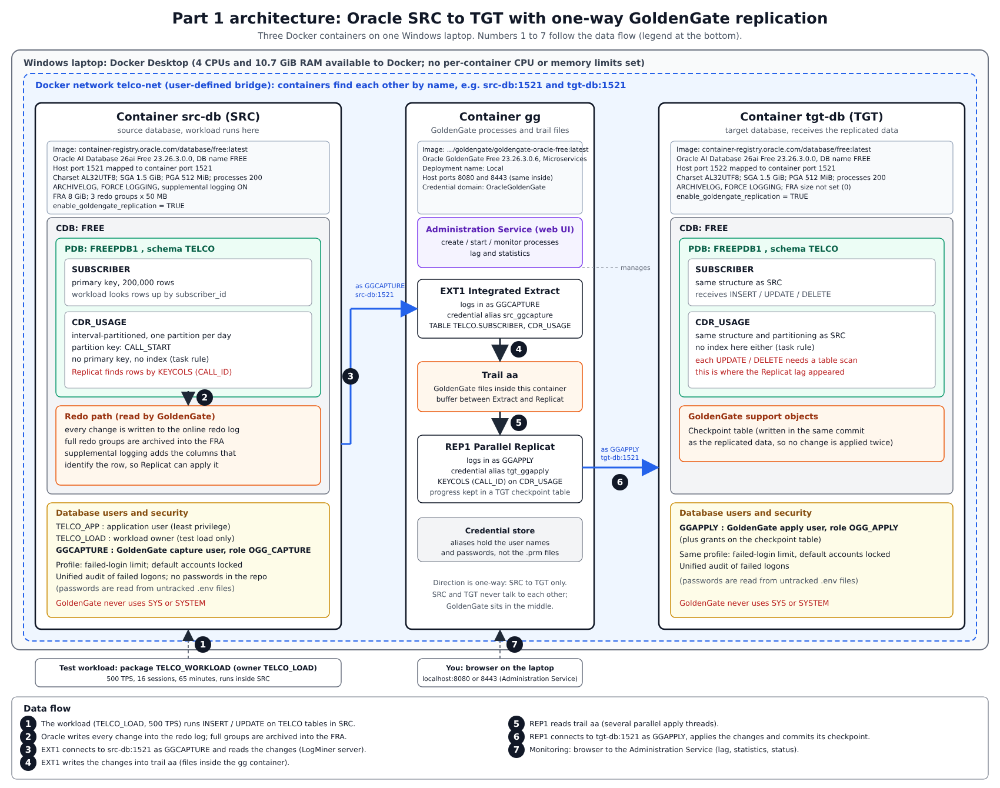

# Telco DBA task: Oracle SRC/TGT with GoldenGate, AWR analysis and tuning

Interview task for Mohaymen. Everything here was run on one Windows laptop with Docker Desktop (Oracle AI Database 26ai Free 23.26.3 and Oracle GoldenGate Free 23.26.3 Microservices). No passwords are stored in the repository; they live in untracked `.env` files.

## Repository map
| Folder | Content |
|---|---|
| `scripts/` | numbered SQL and shell scripts, in the order they were used (01 to 18) |
| `docs/` | setup steps, the AWR analysis, run comparison, GoldenGate sync report, unexpected events, sources, AI usage |
| `outputs/` | raw evidence: command and query outputs, CSV samples, numbered in time order |
| `awr/` | AWR reports (HTML) of the workload runs |
| `diagrams/` | one-page architecture diagram (`architecture.png`, editable `architecture.svg`) |

Start with `docs/part1_setup.md` (how it was built), `docs/part2_awr_analysis.md` (the two problems), `docs/run2_after_fix.md` (comparison) and `docs/part1_gg_sync_report.md` (replication status during the load).

## Architecture

[Open the full-size diagram](diagrams/architecture.png) or the editable [SVG](diagrams/architecture.svg).

Three containers on the Docker network `telco-net`: `src-db` and `tgt-db` (Oracle) and `gg` (GoldenGate). Extract `EXT1` (Integrated) reads the redo of SRC as the least-privilege user `GGCAPTURE`, writes trail `aa`, and Replicat `REP1` (Parallel) applies it to TGT as `GGAPPLY`. The replication is one-way, and GoldenGate never uses SYS or SYSTEM.

## Part 1: environment
- Two Oracle databases (SRC, TGT). SRC: ARCHIVELOG, FRA 8 GB, three 50 MB redo groups.
- Schema `TELCO`: `SUBSCRIBER` (primary key) and `CDR_USAGE` (interval-partitioned daily on `CALL_START`, no primary key, no index, as the task requires).
- Security: profile with a failed-login limit, default accounts locked, failed-logon audit, separate least-privilege users for the application and for GoldenGate.
- GoldenGate Free (Microservices), `EXT1` and `REP1`, verified with an INSERT/UPDATE/DELETE smoke test (`scripts/13_gg_smoke_test.sh`, `outputs/61_gg_smoke_test_clean.txt`).

## Part 2: workload, AWR and two problems
Workload: 500 TPS, 16 sessions, 65 minutes. AWR taken on the PDB (`FREEPDB1`) with manual snapshots.

| Problem | Evidence | Action |
|---|---|---|
| A: query on `CDR_USAGE` with a full table scan (about 22% of DB time) | SQL `1ppfr2kwym0kf`, plan `TABLE ACCESS FULL` | Not applied: the task forbids any index except the `SUBSCRIBER` primary key. Index recommended only. |
| B: literal SQL, hard parsing (about 269 hard parses/s) | 100+ SQL IDs with one `force_matching_signature`, ADDM finding | `CURSOR_SHARING=FORCE` on the PDB as a temporary fix; permanent fix is bind variables in the application. |

| Metric (per second) | Run 1 (before) | Run 2 (after fix) |
|---|---|---|
| Hard parses | 269.4 | 0.1 |
| DB time | 1.3 | 0.8 |
| Transactions | 482.8 | 482.8 |
| `library cache: mutex X` waits | 26,874 | 3,462 |

The transaction rate is the same because the workload is rate-limited. The share of problem A rose (22.5% to 30.1%) only because the total DB time became smaller. Several ADDM suggestions were examined and rejected with numbers (`docs/part2_awr_analysis.md`).

## GoldenGate sync status during the workload
Measured every minute (`scripts/14_gg_sync_sampler.sh`, `scripts/16_gg_lag_sampler.sh`).
- Extract lag stayed at 0 to 5 seconds.
- Replicat lag grew from 866 s to 2302 s during the load and was still growing afterwards (2764 s at 03:06 UTC). At the end of the load about 1.06 million `CDR_USAGE` rows were not yet applied on TGT.
- Likely cause (not proven): `CDR_USAGE` has no index, so each UPDATE/DELETE on TGT needs a table scan. Details and numbers: `docs/part1_gg_sync_report.md`.

## Automation and extras (bonus)
- `scripts/17_verify_environment.sh`: one command that checks 22 Part 1 requirements on both databases (containers, ARCHIVELOG, FRA, redo groups, schema, partitioning, no extra index, profile, failed-logon audit) and prints PASS/FAIL. Read-only. Output: `outputs/68_verify_environment.txt` (22 passed, 0 failed).
- `scripts/18_gg_ctl.sh`: start, stop, status, lag and report of the GoldenGate processes with one command; the admin password never leaves the container.
- `scripts/14_gg_sync_sampler.sh`, `scripts/16_gg_lag_sampler.sh`: automatic measurement of row counts and lag once per minute during the load. `scripts/15_fra_housekeeping.sh`: deletes old archived logs during the run so the FRA does not fill (lab only, no backups exist). `scripts/snapshot_at.sh`: AWR snapshots at fixed minutes.
- The AWR analysis lists ADDM recommendations that were examined and rejected, with the numbers behind each decision.
- Not automated: generating the AWR reports (done with the interactive awrrpt script).

## Deviations, limits and open points
- The task text says "Classic" GoldenGate; I used GoldenGate Free (Microservices), the image that was available to me. I did not ask the company about this.
- Replicat had not caught up when I stopped measuring. The catch-up time (about 3.5 hours by a linear estimate) was not measured.
- After the laptop and Docker were shut down, `INFO ALL` showed EXT1 and REP1 as ABENDED. The end of the EXT1 report shows no error and the REP1 output was empty (`outputs/69_gg_abend_reports.txt`), so I believe they were killed together with the containers, but I did not prove it. At that point TGT held 793,351 of 1,674,507 CDR_USAGE rows (`outputs/68_verify_environment.txt`).
- Unproven hypotheses are marked as such in the documents: the cause of the Replicat lag, the exact mechanism of ORA-14402, and the CPU-cap explanation of `resmgr:cpu quantum`.
- `CALL_ID` is assumed to be unique (it comes from a sequence); the database does not enforce it.
- The first repetition of the second workload run was invalid because the laptop went to sleep; it was repeated (`docs/unexpected_events.md`).

## AI usage
Claude (Anthropic) and DeepSeek were used as assistants. I ran all commands on my own machine and checked the results against my own outputs. Details, including mistakes the assistant made: `docs/ai_usage.md`.

## Rebuild
See `docs/part1_setup.md` for the order of the steps. Passwords are never in the repository: create the `.env` files as described there.
